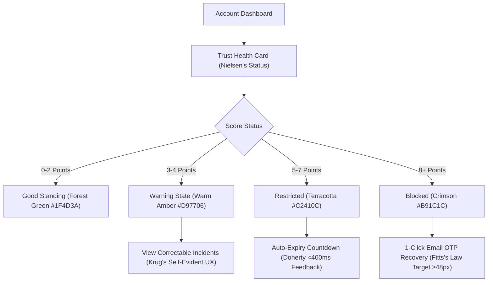

# Flagging and Trust Mechanism — Required Enhancements

This document outlines the concrete architectural roadmap, engineering specifications, and UI/UX designs required to bridge the gap between Section 2.3.2.6 of the research paper and the production application.

---

## Enhancement 1: General Account Inactivity Watcher (Paper Parity)

### Problem Statement
The research paper mandates:
> *"Inactivity for three weeks results in a warning, while one month of inactivity results in account blocking."* (p. 23)
Currently, no subsystem tracks account-level inactivity.

### Proposed Architecture & Implementation Plan
1. **Schema Update (`backend/src/db/schema.ts`):**
   Add `last_active_at: timestamp("last_active_at", { withTimezone: true })` to the `user` table.
   * Update `last_active_at` on authenticated requests using a low-overhead session throttle (e.g., update DB at most once per 6 hours per user).
2. **Background Cron Service (`backend/src/jobs/process-inactivity.ts`):**
   Execute daily within `runScheduledJobs()`:
   * **Stage 1 (21 Days / 3 Weeks):**
     * Query: `where(and(eq(user.isActive, true), lte(user.lastActiveAt, now - 21 days)))`.
     * Action: Queue `account_inactivity_warning` notice via email/push alerting the user that their account will be locked in 9 days unless they log in.
   * **Stage 2 (30 Days / 1 Month):**
     * Query: `where(and(eq(user.isActive, true), lte(user.lastActiveAt, now - 30 days)))`.
     * Action: Set `user.isActive = false`, record a `trust_actions` entry of type `"blocked"` with reason `"Automated deactivation due to 30 days of inactivity"`.
3. **Graceful Self-Reactivation:**
   * Extend the existing Better Auth recovery flow ([`trust.recovery.ts`](file:///c:/Users/Arianne%20Bartiquien/Desktop/Agrivive/backend/src/modules/trust/services/trust.recovery.ts)) so inactive users can restore their accounts seamlessly with an Email OTP without losing historical listings or order history.

---

## Enhancement 2: Reciprocal Buyer Accountability (Failed Reservations)

### Problem Statement
Section 2.3.2.6 cites buyer reservation abandonment as a core input for the trust engine, but currently only seller non-responsiveness and cancellations are penalized.

### Proposed Architecture & Implementation Plan
1. **Track Unclaimed Expired Reservations:**
   * In `backend/src/modules/buyer/services/buyer.order.expire.ts`, when a pending order expires because the buyer did not pick up within the reservation window:
     * Check if seller was present/ready.
     * Record a `trust_events` entry for the buyer:
       ```typescript
       kind: "buyer_failed_reservation",
       classification: "verified",
       subjectId: order.buyersId,
       sourceId: order.id,
       ```
2. **Scoring Policy Weights:**
   * Add `buyer_failed_reservation: 1` to `trustPolicyWeights`.
3. **Proactive Buyer Throttle (Fitts's Law & Error Prevention):**
   * If a buyer reaches the warning threshold (3 points), restrict simultaneous open reservations to a maximum of 1 active order at a time to prevent bulk inventory hoarding.

---

## Enhancement 3: Multi-Category Evidence Verification Pipeline

### Problem Statement
Buyers can report misleading product info, QR misuse, and inappropriate behavior, but these remain dormant as `allegation` records with 0 points.

### Proposed Architecture & Implementation Plan
1. **Evidence Verification State Machine:**
   * Introduce a verification status field in `order_reports`:
     `status: "pending_review" | "verified" | "dismissed"`.
2. **Heuristic & Automated Cross-Verification:**
   * **QR Misuse:** Correlate reports against GPS scan distances between seller profile coordinates and buyer device location during the scan attempt.
   * **Misleading Product Info:** If an order has both an uploaded photo evidence in `order_report_evidence` AND a $\le 2$-star rating, trigger an automated escalation to prioritize the item for review.
3. **Point Escalation:**
   * When an allegation is transitioned to `verified`, trigger `evaluateTrustAction(subjectId)` to apply Equation 3 scoring immediately.

---

## Enhancement 4: Violation Decay & Point Half-Life (Recency Bias Prevention)

### Problem Statement
Currently, `readTrustMonitoringScore` sums all historical verified events that have `invalidatedAt IS NULL`. A minor violation committed 6 months ago permanently burdens a seller.

### Proposed Architecture & Implementation Plan
* **Time-Decay Model:** Apply an exponential half-life or a 90-day rolling window to violation points:
  $$VS_u(t) = \sum_{i=1}^n w_i \cdot v_{u,i} \cdot e^{-\lambda (t - t_{i})}$$
  Where $\lambda$ represents the decay constant (e.g., points reduce by 50% after 90 days of clean transactions).
* **Benefits:** Encourages seller rehabilitation, supports long-term platform retention, and prevents permanent alienation of local farmers.

---

## Enhancement 5: Human-Centered Trust UI/UX Ergonomics

In accordance with Agrivive's UI/UX Laws, all buyer and seller trust touchpoints must implement the following standards:



### Psychological Laws Applied
1. **Visibility of System Status (Jakob Nielsen):**
   * Sellers must never guess their trust rating. Provide a **Trust Health Badge** directly on the seller home dashboard indicating current points, active warnings, and clean streak days.
2. **Don't Make Me Think (Steve Krug):**
   * Replace ambiguous error messages with plain-language banners: *"Your stall is hidden because an inquiry was unanswered for 48 hours. Your account will automatically reactivate on Tuesday at 3:00 PM."*
3. **Fitts's Law & Touch Target Ergonomics (Paul Fitts & Luke Wroblewski):**
   * The "Request Correction" and "Verify Recovery Code" buttons must be at least **48px high** with high-contrast tactile feedback (`:active` press state).
4. **Error Prevention (Caroline Jarrett & Gerry Gaffney):**
   * Warn sellers proactively at the **36-hour mark** before the 48-hour inquiry non-response point penalty triggers.
5. **Peak-End Rule (Daniel Kahneman):**
   * When a temporary restriction expires or an event is successfully corrected, present a reassuring, celebratory banner in Warm Forest Green to rebuild seller morale and trust.
