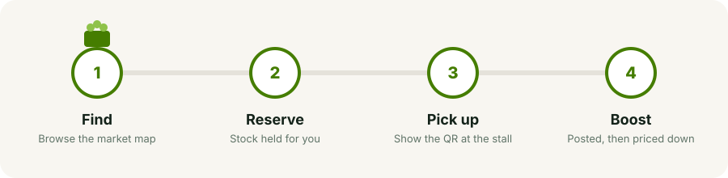
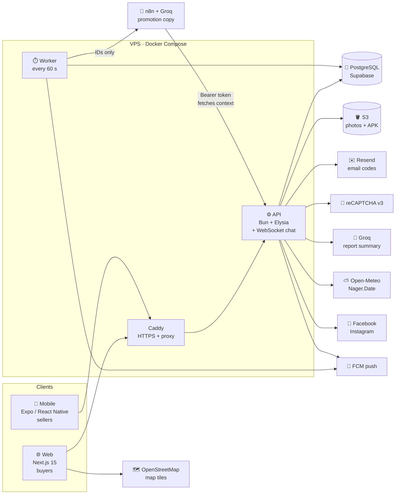
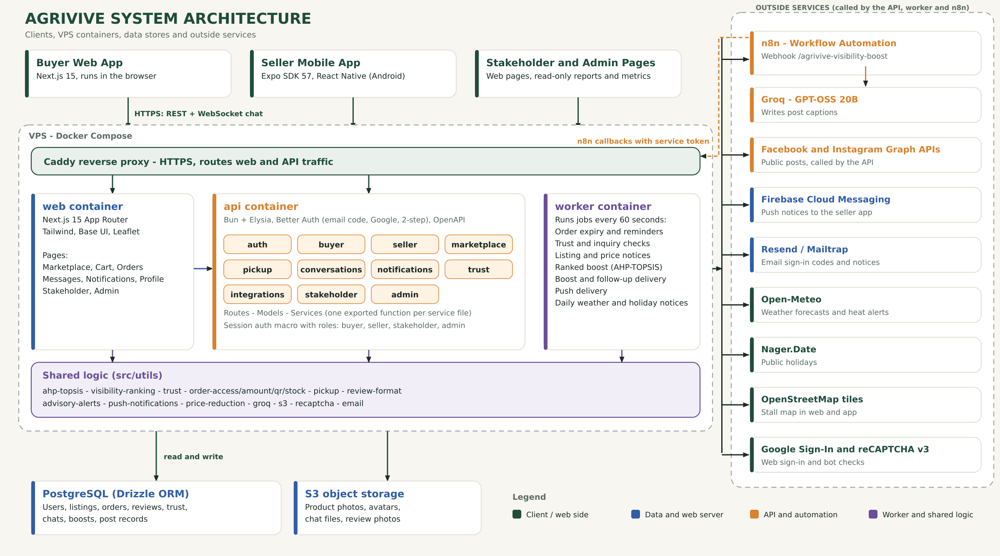
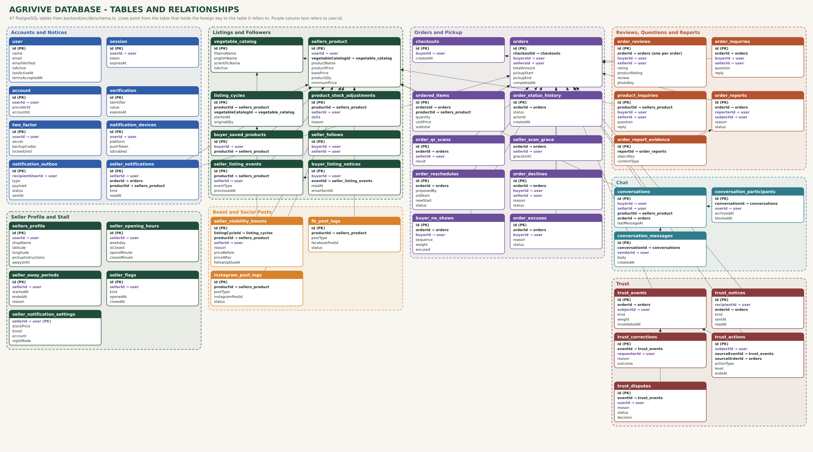

<div align="center">


<br />

### Every harvest deserves a second scene.

**A marketplace that rescues fresh surplus vegetables from Davao City farms and local markets, and puts them in a neighbor's basket before the sun goes down.**

<br />


[**Shop the Harvest**](https://agrivive.tech) &nbsp;·&nbsp; [**Install the Seller App**](https://agrivive.tech/download-app) &nbsp;·&nbsp; [**API Reference**](backend/API_ENDPOINTS.md) &nbsp;·&nbsp; [**Backend Guide**](backend/README.md)

</div>

---

## 🎬 The Premise

At 6 a.m. a vegetable seller arrives with more than they can sell. By noon the lettuce is tired. By evening it is waste.

At the same hour, a few kilometers away, a family is looking for fresh produce at a fair price.

**Agrivive is the scene that connects them.**

Sellers list what they have left. Buyers reserve it from a map and pick a pickup time. A QR pickup pass turns the reservation into a handshake at the stall. In between, the system quietly does the hard work: it ranks listings fairly with AHP-TOPSIS, nudges prices down on a schedule, writes the promotion, posts it to Facebook and Instagram, and keeps both sides honest with a trust score that no admin controls.

> *Nothing is delivered. Nothing is held hostage in a warehouse. Fresh food moves from one pair of hands to another, and the whole story fits in a phone.*

<p align="center">
  
</p>

---

## 🎞️ Now Showing

| | Scene | What happens |
|---|---|---|
| 🗺️ | **Find** | Buyers browse a live market map and category shelves of surplus produce near them. |
| 🧺 | **Reserve** | A cart that splits itself across sellers. The buyer picks Today or Tomorrow and a pickup time inside the stall's opening hours. Stock is held, and the seller has 3 hours to confirm before it confirms by itself. |
| 🎟️ | **Pick up** | A Digital Pickup Pass (QR) that works from the moment of the reservation until 15 minutes after the pickup time ends, so an early buyer is never turned away. The seller scans it and the order completes. If something is wrong at the stall, the buyer can decline with a reason and a photo. After pickup the buyer leaves one review for the whole order: stars for the produce, stars for the seller, one comment and an optional photo, editable for 15 days. |
| 🚀 | **Boost** | Agrivive writes the promotion with AI, posts it to Facebook and Instagram, then lowers the price every 6 hours until the seller's final price. Sellers can turn on Auto-Post so the top-ranked listing is boosted for them. |
| 🧭 | **Rank** | AHP-TOPSIS decides who gets seen first, from listing age, price drop, stock and seller service rating. No pay-to-win. |
| 🛡️ | **Trust** | Weighted points for silence, cancellations, no-shows and low ratings. The system alone decides notices, warnings, pauses and blocks, and every user can dispute and recover. |
| 💬 | **Talk** | Buyer and seller chat in real time, with block, unblock and archive. |
| ⛅ | **Plan** | The seller app shows weather, a heat alert at 35 °C, public holidays, and a reminder one day before each holiday. |

---

## 🎭 The Cast

Four roles, one account system. A person can hold both a Buyer and a Seller role on one email.

| Role | Where they live | What they do |
|---|---|---|
| **Buyer** | Web ([`web/`](web)) | Browse the map, follow sellers, save produce, reserve with a pickup time, chat, show the pickup pass, review the order. |
| **Seller** | Mobile app ([`mobile/`](mobile)) | Set up the stall and its opening hours, add listings, set price drops, scan pickup passes, Boost a product, answer questions, read the sales report (with an AI-written summary), and check weather and holiday reminders. |
| **Stakeholder** | Web | A read-only dashboard of marketplace activity: totals, a 30-day orders chart, and the most rescued produce. |
| **Admin** | Web | A read-only performance view (system metrics). Admins make no trust or penalty decisions. |

---

## 🏗️ Behind the Scenes



**Two processes, one codebase.** [`src/index.ts`](backend/src/index.ts) serves HTTP. [`src/worker.ts`](backend/src/worker.ts) runs the scheduled jobs: reservation expiry, trust and reply timers, new-listing notices, ranked Boost rounds, Boost follow-ups and price cuts, push delivery, and the daily weather and holiday notices. Run exactly one worker.

**n8n gets IDs, never secrets.** The worker tells n8n only *which* boost to run. n8n then calls back into protected `/integrations/*` routes with a service token to fetch the current facts. Credentials for Meta, FCM, S3 and email stay server-side.

---

### Diagrams

<p align="center">
  
</p>

<p align="center">
  
</p>

---

## 🧰 Production Stack

| Layer | Tech |
|---|---|
| **API** | Bun, Elysia, TypeScript (strict), Better Auth (email OTP, Google, 2FA), OpenAPI |
| **Database** | PostgreSQL on Supabase (47 tables), Drizzle ORM, hand-reviewed migrations |
| **Web** | Next.js 15 App Router, React 19, Tailwind 3, GSAP + Lenis, Leaflet, Base UI, shadcn |
| **Mobile** | Expo SDK 58, React Native 0.88, expo-router, Better Auth Expo client, EAS Build |
| **Automation** | n8n workflow ([`n8n/workflows/`](n8n/workflows)) with Groq (`openai/gpt-oss-20b`) for promotion copy; the API also asks Groq for the seller report summary (with a built-in fallback) |
| **Storage, mail & push** | AWS S3, Resend (Mailtrap in development), Firebase Cloud Messaging |
| **Outside data** | Open-Meteo (weather), Nager.Date (holidays), OpenStreetMap (map tiles), Facebook and Instagram Graph APIs |
| **Ops** | Docker Compose, Caddy, GitHub Actions (CI per app, manual CD) |

---

## 🧠 The Smart Parts

### Fair visibility, by the numbers
Listings are ranked with **AHP-TOPSIS**. Four criteria, all counted as "bigger is better", are weighted by AHP (consistency ratio about 0.004):

| Criterion | Weight | Meaning |
|---|---|---|
| Posting age | 0.351 | Hours since the listing was posted. Produce that has waited longer is shown first. |
| Price drop | 0.351 | Base price minus the current price. |
| Stock level | 0.189 | Quantity left. |
| Seller reliability | 0.109 | Average order service rating out of 5 (2.5 for a seller with no reviews). |

TOPSIS turns them into a closeness score between 0 and 1. Equal scores break by newest listing, then by id, so the order never flickers. There are no priority tiers: the ranking is the result. The same ranking picks which listing the automatic Boost round posts next (only for sellers who turned on Auto-Post, and only when `AUTO_BOOST_ENABLED=true`). A listing is never picked again within 6 hours. Set `VISIBILITY_POLICY=visibility-v4` to roll back to the old formula.

See [`backend/src/utils/ahp-topsis`](backend/src/utils/ahp-topsis), [`visibility-ranking`](backend/src/utils/visibility-ranking) and [`visibility-score`](backend/src/utils/visibility-score).

### Boost, the 6-hour countdown
1. A seller adds a product. The first post is a normal post, and the seller can allow **Auto-Post** (Boost > Settings) so Agrivive posts for them later.
2. The worker confirms a boost and calls n8n with only the boost ID. n8n fetches the facts, Groq writes the caption, and the backend posts to Facebook and Instagram and saves each result.
3. Six hours later the seller is asked to set a peso drop and a final price. After that the worker lowers the price by that amount (never below the final price) every 6 hours and n8n posts a flash-sale caption again.
4. It repeats until the final price, a sellout, or the seller turns it off. A crash can never cause a double post.

### Trust, with a way back
Points are weighted by how serious the event is and only the last 90 days count:

| Points | Events |
|---|---|
| 1 | Seller does not answer a question or chat, a 1 to 2 star service rating, a late buyer cancellation, an invalid decline, fake reports, chat spam or personal data in chat |
| 2 | Seller cancels a confirmed order, seller at fault when declined at pickup, buyer misses pickup, false decline photo, confirmed misleading information or rude messages |
| 3 and an immediate block | QR misuse, ordering from your own stall |

A report alone is 0 points. It becomes a violation only when two different people report the same thing. Extra orders past 5 in 7 days from one buyer to one seller, and rating floods from brand-new accounts, are ignored.

```
 2 pts   →  notice
 4 pts   →  warning
 6 pts   →  24-hour pause
 8 pts   →  3-day pause
12 pts   →  account blocked      (or one serious violation)
```

A seller's pause or block also needs a fault rate of 10% or more over at least 10 orders. Reply timers remind at 12 hours, warn at 24, and mark non-responsive at 48; Away mode stops that clock. Accounts inactive for 3 weeks get a warning and after 30 days are blocked. Users can dispute or excuse an event, and a blocked account restores through an email code. Sellers with a 4.5 rating and 20 completed orders earn the Trusted Seller badge. **No admin decides any of this.** Details live in [`backend/README.md`](backend/README.md).

### One review per order
A buyer reviews a completed order once, on one screen: product stars, seller service stars, one optional comment and an optional photo, editable for 15 days. Only the seller service stars feed the seller rating, the ranking and trust points. Product stars show on the product page.

### The seller report
Sell-through rate (sold divided by posted), the change from the previous period, pesos earned, best sellers and busiest days, all for any dates the seller picks on a calendar. The short summary is written by Groq from those numbers only, checked so it cannot invent a figure, saved while the numbers stay the same, and replaced by fixed sentences if Groq is slow or off. It describes what happened; Agrivive does not predict sales or demand.

### Bot protection and consent
Google **reCAPTCHA v3** guards sign-up, sign-in, code sending and account recovery. Every new account records when and which version of the Privacy Policy and Terms it accepted. Legal pages: [`/privacy`](https://agrivive.tech/privacy), [`/terms`](https://agrivive.tech/terms), [`/cookies`](https://agrivive.tech/cookies).

---

## 🗂️ The Set

```text
Agrivive/
├── backend/            Bun + Elysia API and worker
│   ├── src/
│   │   ├── index.ts        HTTP API
│   │   ├── worker.ts       scheduled jobs (60 s)
│   │   ├── db/             Drizzle schema + relations
│   │   ├── plugins/        security headers, rate limit, validation
│   │   ├── modules/        admin · auth · buyer · conversations · integrations
│   │   │                   marketplace · notifications · pickup · seller · stakeholder · trust
│   │   └── utils/          ahp-topsis · trust · visibility-* · groq · s3 · email · recaptcha …
│   └── drizzle/        timestamped migrations
├── web/                Next.js buyer site
├── mobile/             Expo seller app
├── n8n/workflows/      exported Boost workflow (no credentials)
├── Agrivive/           Obsidian vault: the development record
├── .github/workflows/  CI per app, manual CD
├── docker-compose.yml  API · worker · web · Caddy
└── Caddyfile           HTTPS and routing
```

Each backend module follows one shape: `index/` routes, `model/` request schemas, `services/` database and business logic (one exported function per file). Shared logic used by several modules lives in `src/utils/<name>/index.ts`.

---

## ▶️ Roll Camera (Local Setup)

You need [Bun](https://bun.sh), PostgreSQL, and Node for Expo tooling.

**1. Backend**
```bash
cd backend
cp .env.example .env                 # set DATABASE_URL and the providers you need
bun install --frozen-lockfile
bunx drizzle-kit migrate             # explicit step; the app never migrates on startup
bun run dev                          # API on http://localhost:3000 (OpenAPI UI included)
bun run worker:dev                   # second terminal: the scheduled worker
```

**2. Web**
```bash
cd web
cp .env.example .env.local           # NEXT_PUBLIC_API_URL defaults to http://localhost:3000
bun install --frozen-lockfile
bun run dev                          # http://localhost:3001
```

**3. Mobile**
```bash
cd mobile
cp .env.example .env
bun install --frozen-lockfile
bun run start                        # Expo dev server
```

Leave `RECAPTCHA_SECRET_KEY` empty locally and the captcha checks are skipped. For email, set `EMAIL_PROVIDER=mailtrap` in development.

### Checks before every cut

| App | Commands |
|---|---|
| Backend | `bun test` · `bunx tsc --noEmit` · `bun build src/index.ts --outdir dist --target bun` · `bun build src/worker.ts --outdir dist --target bun` · `bunx drizzle-kit check` |
| Web | `bun run typecheck` · `bun run build` |
| Mobile | `bun run typecheck` · `node ./node_modules/expo/bin/cli export --platform android` |

Backend logic is covered by `bun test` (260 tests: ranking, reservations and pickup, trust and flagging, reviews, and the sales report), run from `backend/`. Endpoints are also checked by hand in the OpenAPI UI or Postman. Note: `backend/dist/` is tracked in git because Docker runs `bun dist/index.js`, so rebuild and check `git status` before a release.

---

## 🚢 Premiere (Deploy)

1. **Merge to `main`**, then run the manual CD workflow for what changed: [`backend-cd.yml`](.github/workflows/backend-cd.yml) or [`web-cd.yml`](.github/workflows/web-cd.yml). They ship a release to the VPS through [`scripts/vps-release.sh`](scripts/vps-release.sh).
2. **Migrations are a release step.** Apply them on purpose, before the new API serves traffic.
3. **Mobile** is built with EAS: `eas build --profile preview --platform android` makes the installable APK, and `--profile production` makes the store bundle. Deploy the backend first, since the app depends on its latest changes. Upload it to S3 and the website links to it. The page at `/download-app` walks sellers through installing it.

Public build variables (safe to expose): `NEXT_PUBLIC_API_URL`, `NEXT_PUBLIC_RECAPTCHA_SITE_KEY`, `EXPO_PUBLIC_API_URL`, `EXPO_PUBLIC_WEB_URL`, `EXPO_PUBLIC_RECAPTCHA_SITE_KEY`. **Everything else is a secret and lives only in the server `.env`.** Never commit it.

---

## 📚 The Script Supervisor (Docs)

| Doc | What is in it |
|---|---|
| [`backend/README.md`](backend/README.md) | Local setup, Boost flow, trust rules, notifications, consent and captcha |
| [`backend/API_ENDPOINTS.md`](backend/API_ENDPOINTS.md) | Endpoint contracts |
| [`Agrivive/docs/`](Agrivive/docs) | Architecture and database diagrams, AHP-TOPSIS and n8n specification, test sheets |
| [`AGENTS.md`](AGENTS.md) | Project conventions: module layout, 200-line file limit, plain-word copy, UI/UX principles |
| [`Agrivive/04 Delivery/00-LATEST.md`](Agrivive/04%20Delivery/00-LATEST.md) | The current project snapshot |
| [`Agrivive/04 Delivery/`](Agrivive/04%20Delivery) | One dated note for every finished task: the changelog |
| [`web/AGENTS.md`](web/AGENTS.md) · [`mobile/AGENTS.md`](mobile/AGENTS.md) | App-specific guidance |

---

## 🎨 House Style

- **Plain words.** Labels and messages are written so a five-year-old could read them: *Add More*, *Take Away*, *Change Amount*.
- **Forest Green `#457D00` on Warm Cream `#F8F6F1`**, crisp 1px borders, soft shadows, 48px minimum buttons.
- Interfaces cite the laws they follow (Jakob's Law, Hick-Hyman, Fitts's Law, the Peak-End Rule) so design decisions stay explainable.
- Files stay under 200 lines. Errors show under the field they belong to.

---

## 🎬 Credits

Built as a capstone project by **Bartiquien, Jara and Marundan**, with one stubborn idea: **fresh food should find a table, not a bin.**

Maintained at [`jjoaquin-dev/Agrivive`](https://github.com/jjoaquin-dev/Agrivive).

<div align="center">

<br />

*Fade to green.*

**Agrivive** · Davao City

</div>
