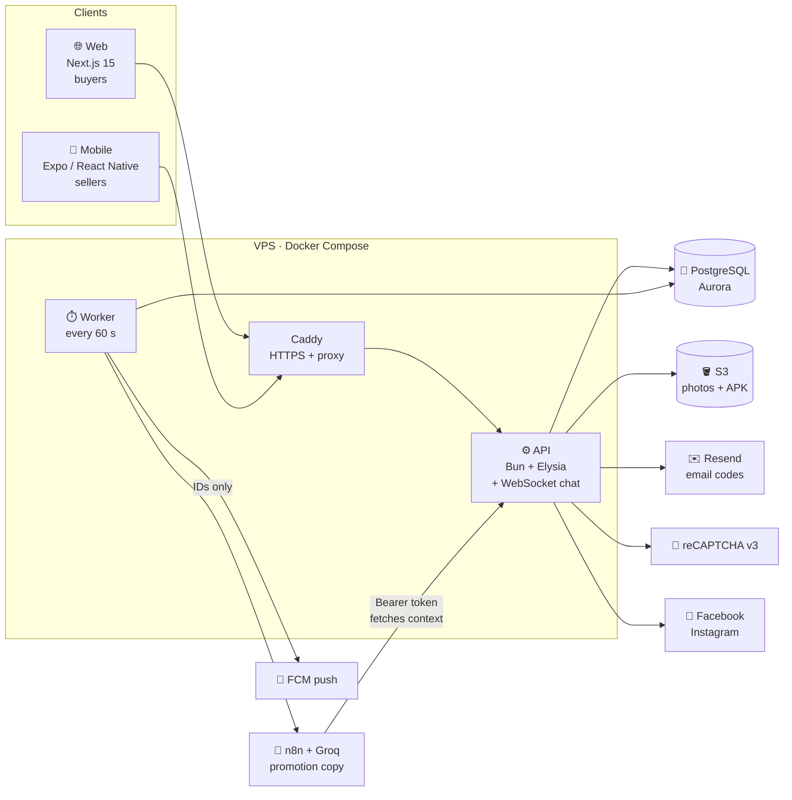

<div align="center">


<br />

### Every harvest deserves a second scene.

**A marketplace that rescues fresh surplus vegetables from Davao City farms and local markets, and puts them in a neighbor's basket before the sun goes down.**

<br />


[**Shop the Harvest**](https://agrivive.tech) &nbsp;·&nbsp; [**Install the Seller App**](https://agrivive.tech/download-app) &nbsp;·&nbsp; [**API Reference**](backend/API_ENDPOINTS.md) &nbsp;·&nbsp; [**Backend Guide**](backend/README.md)

</div>

---

## 🎬 The Premise

At 6 a.m. a vegetable seller arrives with more than they can sell. By noon the lettuce is tired. By evening it is waste.

At the same hour, a few kilometers away, a family is looking for fresh produce at a fair price.

**Agrivive is the scene that connects them.**

Sellers list what they have left. Buyers reserve it from a map. A QR pickup pass turns the reservation into a handshake at the stall. In between, the system quietly does the hard work: it ranks listings fairly, nudges prices down on a schedule, writes the promotion, posts it to Facebook and Instagram, and keeps both sides honest with a trust score.

> *Nothing is delivered. Nothing is held hostage in a warehouse. Fresh food moves from one pair of hands to another, and the whole story fits in a phone.*

---

## 🎞️ Now Showing

| | Scene | What happens |
|---|---|---|
| 🗺️ | **Find** | Buyers browse a live market map and category shelves of surplus produce near them. |
| 🧺 | **Reserve** | A cart that splits itself across sellers. Stock is held for a limited time, so nobody loses out. |
| 🎟️ | **Pick up** | A Digital Pickup Pass (QR). The seller scans it, the order completes, both sides rate each other. |
| 🚀 | **Boost** | One tap and Agrivive writes the promotion with AI, posts it to Facebook and Instagram, then lowers the price every 6 hours until the seller's final price. |
| 🧭 | **Rank** | AHP-TOPSIS decides who gets seen first. Priority Boost, Standard Exposure, Basic. No pay-to-win. |
| 🛡️ | **Trust** | Weighted points for silence, cancellations and low ratings. Warnings, pauses, blocks, and a path back. |

---

## 🎭 The Cast

Four roles, one account system. A person can hold both a Buyer and a Seller role on one email.

| Role | Where they live | What they do |
|---|---|---|
| **Buyer** | Web ([`web/`](web)) | Browse the map, favorite sellers, reserve produce, chat, show the pickup pass, leave reviews. |
| **Seller** | Mobile app ([`mobile/`](mobile)) | Add listings, set price drops, scan pickup passes, Boost a product, answer questions, read analytics, check weather and holidays. |
| **Stakeholder** | Web | A read-only summary of marketplace activity, with a print layout. |
| **Admin** | Web | Performance monitoring and trust oversight. |

---

## 🏗️ Behind the Scenes



**Two processes, one codebase.** [`src/index.ts`](backend/src/index.ts) serves HTTP. [`src/worker.ts`](backend/src/worker.ts) runs the scheduled jobs: reservation expiry, trust and reply timers, new-listing notices, Boost follow-ups and price cuts, push delivery. Run exactly one worker.

**n8n gets IDs, never secrets.** The worker tells n8n only *which* boost to run. n8n then calls back into protected `/integrations/*` routes with a service token to fetch the current facts. Credentials for Meta, FCM, S3 and email stay server-side.

---

## 🧰 Production Stack

| Layer | Tech |
|---|---|
| **API** | Bun, Elysia, TypeScript (strict), Better Auth (email OTP, Google, 2FA), OpenAPI |
| **Database** | PostgreSQL (AWS Aurora), Drizzle ORM, hand-reviewed migrations |
| **Web** | Next.js 15 App Router, React 19, Tailwind 3, GSAP + Lenis, Leaflet, Base UI, shadcn |
| **Mobile** | Expo SDK 58, React Native 0.88, expo-router, Better Auth Expo client, EAS Build |
| **Automation** | n8n workflow ([`n8n/workflows/`](n8n/workflows)) with Groq for promotion copy |
| **Storage & mail** | AWS S3, Resend (Mailtrap in development) |
| **Ops** | Docker Compose, Caddy, GitHub Actions (CI per app, manual CD) |

---

## 🧠 The Smart Parts

### Fair visibility, by the numbers
Listings are ranked with **AHP-TOPSIS**: weighted criteria (recency, rating reliability and more) produce a closeness score between 0 and 1.

| Closeness | Tier | Effect |
|---|---|---|
| `≥ 0.60` | **Priority Boost** | Eligible for the Boost promotion flow |
| `0.40 – 0.60` | **Standard Exposure** | Normal placement |
| `< 0.40` | **Basic** | Lowest placement |

See [`backend/src/utils/ahp-topsis`](backend/src/utils/ahp-topsis), [`visibility-score`](backend/src/utils/visibility-score) and [`promotion-eligibility`](backend/src/utils/promotion-eligibility).

### Boost, the 6-hour countdown
1. A seller adds a product and taps **Boost**.
2. n8n and Groq write a title and description. The backend posts to Facebook and Instagram.
3. Six hours later the worker wakes the same flow, lowers the price by the seller's peso amount (never below their final price), and posts again.
4. It repeats until the final price, a sellout, or the seller turns it off. A crash can never cause a double post.

### Trust, with a way back
Violations carry weights: a seller who never answers (1), a seller cancellation (2), a buyer no-show (2), a 1 to 2 star rating (1), confirmed misleading information or rude messages (2), QR misuse (3).

```
 4 pts  →  warning
 6 pts  →  12-hour pause
 8 pts  →  24-hour pause
10 pts  →  3-day pause
12 pts  →  account blocked      (or one QR misuse)
```

Old mistakes fade after 90 days. Reply timers remind at 12 hours, warn at 24, and mark non-responsive at 48. Blocked accounts restore through an email code. Details live in [`backend/README.md`](backend/README.md).

### Bot protection and consent
Google **reCAPTCHA v3** guards sign-up, sign-in, code sending and account recovery. Every new account records when and which version of the Privacy Policy and Terms it accepted. Legal pages: [`/privacy`](https://agrivive.tech/privacy), [`/terms`](https://agrivive.tech/terms), [`/cookies`](https://agrivive.tech/cookies).

---

## 🗂️ The Set

```text
Agrivive/
├── backend/            Bun + Elysia API and worker
│   ├── src/
│   │   ├── index.ts        HTTP API
│   │   ├── worker.ts       scheduled jobs (60 s)
│   │   ├── db/             Drizzle schema + relations
│   │   ├── plugins/        security headers, rate limit, validation
│   │   ├── modules/        admin · auth · buyer · conversations · integrations
│   │   │                   marketplace · notifications · seller · stakeholder · trust
│   │   └── utils/          ahp-topsis · trust · visibility-* · s3 · email · recaptcha …
│   └── drizzle/        timestamped migrations
├── web/                Next.js buyer site
├── mobile/             Expo seller app
├── n8n/workflows/      exported Boost workflow (no credentials)
├── Agrivive/           Obsidian vault: the development record
├── .github/workflows/  CI per app, manual CD
├── docker-compose.yml  API · worker · web · Caddy
└── Caddyfile           HTTPS and routing
```

Each backend module follows one shape: `index/` routes, `model/` request schemas, `services/` database and business logic (one exported function per file). Shared logic used by several modules lives in `src/utils/<name>/index.ts`.

---

## ▶️ Roll Camera (Local Setup)

You need [Bun](https://bun.sh), PostgreSQL, and Node for Expo tooling.

**1. Backend**
```bash
cd backend
cp .env.example .env                 # set DATABASE_URL and the providers you need
bun install --frozen-lockfile
bunx drizzle-kit migrate             # explicit step; the app never migrates on startup
bun run dev                          # API on http://localhost:3000 (OpenAPI UI included)
bun run worker:dev                   # second terminal: the scheduled worker
```

**2. Web**
```bash
cd web
cp .env.example .env.local           # NEXT_PUBLIC_API_URL defaults to http://localhost:3000
bun install --frozen-lockfile
bun run dev                          # http://localhost:3001
```

**3. Mobile**
```bash
cd mobile
cp .env.example .env
bun install --frozen-lockfile
bun run start                        # Expo dev server
```

Leave `RECAPTCHA_SECRET_KEY` empty locally and the captcha checks are skipped. For email, set `EMAIL_PROVIDER=mailtrap` in development.

### Checks before every cut

| App | Commands |
|---|---|
| Backend | `bunx tsc --noEmit` · `bun build src/index.ts --outdir dist --target bun` · `bun build src/worker.ts --outdir dist --target bun` · `bunx drizzle-kit check` |
| Web | `bun run typecheck` · `bun run build` |
| Mobile | `bun run typecheck` · `node ./node_modules/expo/bin/cli export --platform android` |

There is no automated test runner. The owner verifies endpoints by hand in the OpenAPI UI or Postman. Note: `backend/dist/` is tracked in git because Docker runs `bun dist/index.js`, so rebuild and check `git status` before a release.

---

## 🚢 Premiere (Deploy)

1. **Merge to `main`**, then run the manual CD workflow for what changed: [`backend-cd.yml`](.github/workflows/backend-cd.yml) or [`web-cd.yml`](.github/workflows/web-cd.yml). They ship a release to the VPS through [`scripts/vps-release.sh`](scripts/vps-release.sh).
2. **Migrations are a release step.** Apply them on purpose, before the new API serves traffic.
3. **Mobile** is built with EAS: `eas build --profile preview --platform android` makes the installable APK. Upload it to S3 and the website links to it. The page at `/download-app` walks sellers through installing it.

Public build variables (safe to expose): `NEXT_PUBLIC_API_URL`, `NEXT_PUBLIC_RECAPTCHA_SITE_KEY`, `EXPO_PUBLIC_API_URL`, `EXPO_PUBLIC_WEB_URL`, `EXPO_PUBLIC_RECAPTCHA_SITE_KEY`. **Everything else is a secret and lives only in the server `.env`.** Never commit it.

---

## 📚 The Script Supervisor (Docs)

| Doc | What is in it |
|---|---|
| [`backend/README.md`](backend/README.md) | Local setup, Boost flow, trust rules, notifications, consent and captcha |
| [`backend/API_ENDPOINTS.md`](backend/API_ENDPOINTS.md) | Endpoint contracts |
| [`AGENTS.md`](AGENTS.md) | Project conventions: module layout, 200-line file limit, plain-word copy, UI/UX principles |
| [`Agrivive/04 Delivery/00-LATEST.md`](Agrivive/04%20Delivery/00-LATEST.md) | The current project snapshot |
| [`Agrivive/04 Delivery/`](Agrivive/04%20Delivery) | One dated note for every finished task: the changelog |
| [`web/AGENTS.md`](web/AGENTS.md) · [`mobile/AGENTS.md`](mobile/AGENTS.md) | App-specific guidance |

---

## 🎨 House Style

- **Plain words.** Labels and messages are written so a five-year-old could read them: *Add More*, *Take Away*, *Change Amount*.
- **Forest Green `#457D00` on Warm Cream `#F8F6F1`**, crisp 1px borders, soft shadows, 48px minimum buttons.
- Interfaces cite the laws they follow (Jakob's Law, Hick-Hyman, Fitts's Law, the Peak-End Rule) so design decisions stay explainable.
- Files stay under 200 lines. Errors show under the field they belong to.

---

## 🎬 Credits

Built as a capstone project by **Bartiquien, Jara and Marundan**, with one stubborn idea: **fresh food should find a table, not a bin.**

Maintained at [`jjoaquin-dev/Agrivive`](https://github.com/jjoaquin-dev/Agrivive).

<div align="center">

<br />

*Fade to green.*

**Agrivive** · Davao City

</div>
